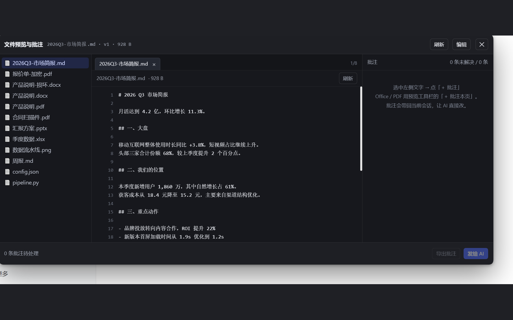
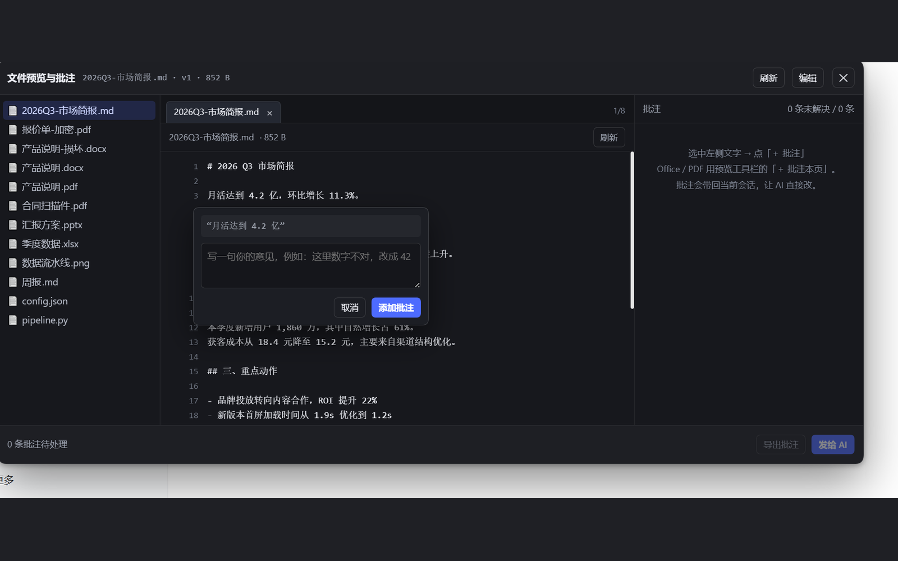
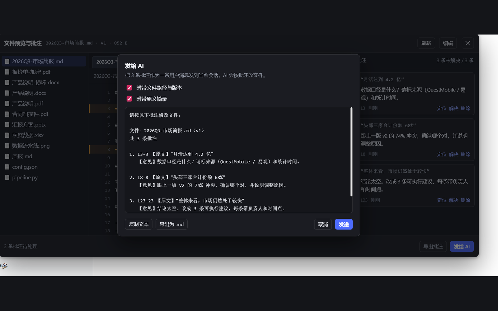
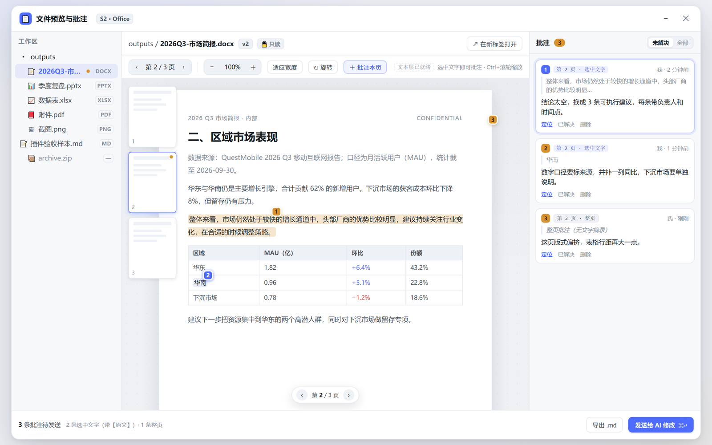
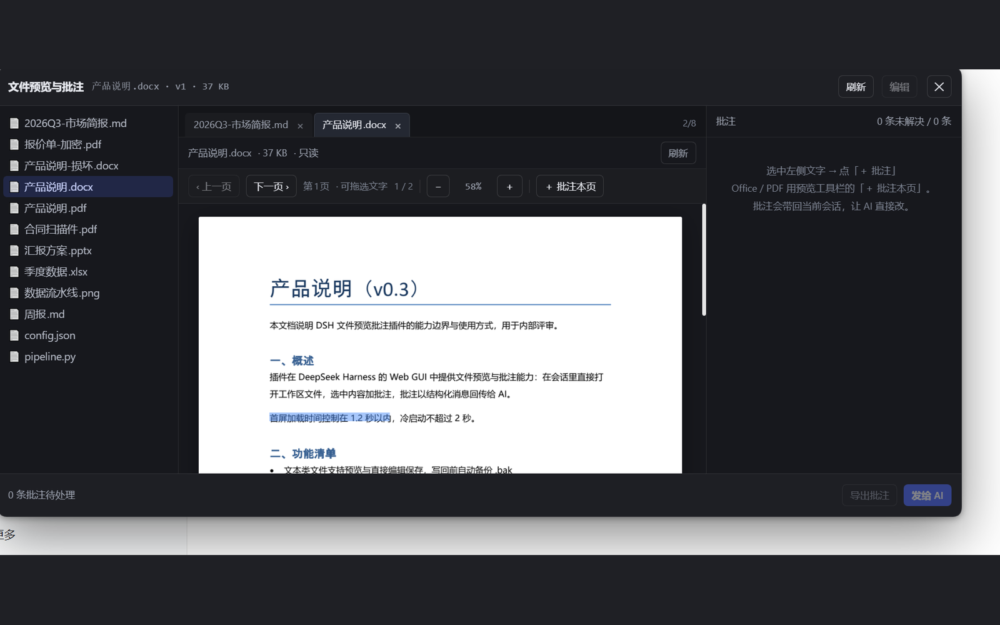
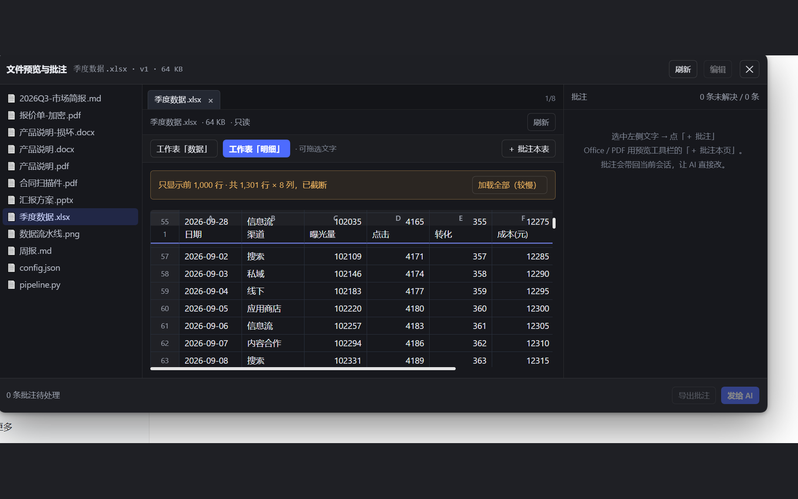
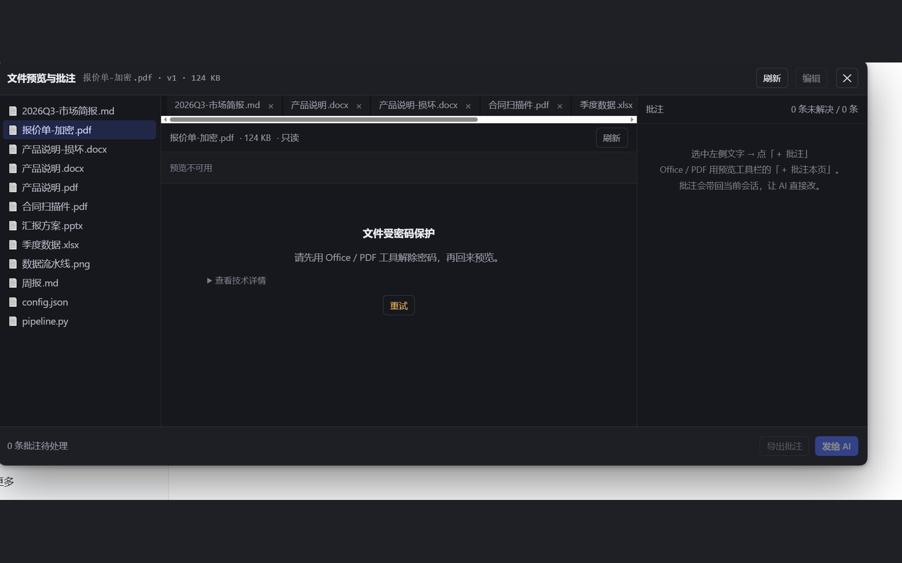
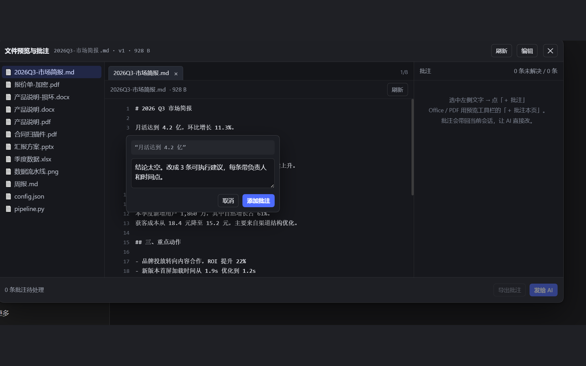

# dsh-file-review

在 DeepSeek Harness 的 Web GUI 里**预览 AI 产出的文件、选中直接改或加批注、把批注一键发回给 AI**，让「看一遍 → 指出来 → AI 改」变成一次闭环，而不是反复重做。

<p align="center">
  
</p>

> 状态：**S1 文本链路 已完成真机跑通**（2026-11-20）；**S2 Office / PDF / 图片预览与批注 已完成验收**（2026-11-22：docx/xlsx/pptx/pdf 四格式预览+批注、冻结窗格、大表截断、加密错误态、缩放文字层偏移 0.03px 均通过）；**S4 开源发布进行中**。验证细节见 [CHANGELOG](CHANGELOG.md#验证记录)。

## 为什么做

AI 生成文件后，人打开总发现细节问题；用聊天描述回去既费 token、又容易改出新问题。这个插件把「预览 + 直接编辑 + 批注」放进同一个面板，批注附带**文件路径 + 位置 + 原文摘录 + 意见**，一键送进当前会话，AI 拿到的是可执行的结构化反馈。

## 功能

- **文本类（S1，已完成）**
  - 预览：`.md` `.txt` `.csv` `.json` `.yaml` `.py` `.js` `.ts` `.html` `.css` 等
  - 直接编辑保存（写回前自动备份 `.bak`，冲突时提示而非覆盖）
  - 选中文本 → 加批注（锚点＝行号区间）；批注列表可编辑/删除
  - 「发给 AI」：格式化成结构化消息（含文件路径、版本、`L<起>-<止>` 行号、原文、意见），发进当前会话
- **Office / PDF / 图片（S2，已完成）**
  - docx / pptx / pdf：页图 + **透明文字层**，可以像 txt/md 一样选中原文加批注；扫描件等无文字层时提示并保留**整页批注**兜底
  - xlsx：**DOM 表格**渲染——行号列标、网格线、列宽、合并单元格、文字原生可选，批注落到单元格或区域；首行/首列冻结（滚动不脱位），大表先渲 1,000 行并给明确截断条（可确认后加载全部）
  - 图片：png/jpg/jpeg/gif/webp/bmp 只读预览 + 整图批注（消息 `图片 【意见】…`，不带页号行号）
  - 错误态：加密 / 超大 / 转换超时 / 坏 XML 统一错误卡（一句人话 + 重试、技术细节折叠；批注入口置灰但已有批注保留）
- **计划中（S3+）**
  - AI 改完原地刷新并高亮 diff、批注持久化、多文件标签、快捷键、拖拽打开

## 界面预览

> 图为设计参考稿渲染（假数据、已脱敏），顶部 GIF 为设计稿走查演示；真机截图/录屏出来后同名替换，README 引用不变。

<p align="center">
  
</p>

**文本批注**



工作区任意 md / txt / csv / 代码，点开就是可编辑的预览，右侧是批注栏。



选中一段文字，写一句意见，批注就挂在原文上 —— 不用复制粘贴给 AI。

**发给 AI 前的确认**



发给 AI 前先看清楚：文件、版本、每条批注的行号和原文都在消息里，可勾选、可改。

**Office / PDF**



Word、PPT、PDF 直接看，不用先导出成图。



Office 里也能选字批注，消息里带的是页码和原文摘录。

**表格**


表格按单元格真实渲染：网格、行号列标、右对齐数字，跟 Office 一致。



首行冻结、滚动到第 40 行也认得出列。

**图片**


图片也能整图批注：`图片 【意见】…`，不带页号行号。

**边界与状态**

| 扫描件无文字层 | 加密 / 超大 / 超时 | 大表截断 |
|---|---|---|
|  |  |  |

- 扫描件没有文字层？提示你只能整页批注，不会给你假的可选文字。
- 加密 / 超大 / 超时都用同一张错误卡：一句人话 + 重试，技术细节折叠起来。
- 上万行的表先渲染前 1000 行，明确告诉你截断了，不静默截断也不卡死。

**深色模式**



跟随 DSH 主题，深色下批注序号、选中高亮同样清晰。

## 安装

前置：Node.js >= 22（实测 v24.18.0）；Windows PowerShell 下 `npm.ps1` 可能被执行策略拦截，用 `npm.cmd` 调用。

```powershell
# 1) 装依赖并构建
& "C:\Program Files\nodejs\npm.cmd" install
& "C:\Program Files\nodejs\npm.cmd" run build    # tsc 出 Host 半 + tsdown 出 Client 半
& "C:\Program Files\nodejs\npm.cmd" run verify   # 构建 + bundle 契约 + Host/Client 离线自测

# 2) 装进 desktop profile（本地路径）
dsh plugin --profile desktop add "C:\...\dsh-file-review"
```

安装已在真机验证（2026-11-20，desktop profile，重启宿主后输入条出现「📝 批注」入口）。验证是否装进组合树，别用 `dsh --profile desktop --dump-config`：desktop profile 由 Electron 桌面宿主独占管理，该命令会报 `profile "desktop" is managed exclusively by the Electron application`（exit 1）。可行方式两种：

1. 在隔离的 `DSH_HOME` 里装 web profile 后跑 `dsh --profile web --dump-config` 检查组合树（步骤见 [docs/install.md](docs/install.md) §4）；
2. 重启桌面宿主后，看会话输入条左侧是否出现「📝 批注」入口。

- Host 半插件装进 desktop profile 后**需要重启桌面宿主（`dsh web`）** 才生效（重启会断当前会话、端口会变）；之后仅改 Client 半时 rebuild + 刷新页面即可。
- 工程依赖统一用 **npm**（仓库带 `package-lock.json`）。`dsh plugin` 内部装插件时用 DSH 自带的 pnpm 11.28.5，那只服务装插件，不要用它装工程依赖、不要混 lockfile（在工程里跑 `pnpm install` 会生成第二套锁文件）。
- 安装、重启影响、验收清单的权威版本见 [docs/install.md](docs/install.md)（Claw 实测，2026-11-18）。
- 发送链路：客户端「发给 AI」走 Host `/plugins/dsh-file-review/api/send` → `ctx.sessionController.prompt`；隔离实例与真机均已验证会话里会收到带行号/页号的结构化批注消息。

## 使用

1. 打开 Web GUI 会话，点输入条左侧的「📝 批注」入口打开浮层面板。
2. 在文件树里选工作区内的文件。
3. 文本文件：直接改 → 保存；或选中一段 → 加批注。
   Office/PDF：在页图上选中原文 → 加批注；无文字层时用「＋ 批注本页」兜底。
   xlsx：点单元格或拖选区域 → 加批注。
4. 点「发给 AI」，确认结构化批注消息进入输入框（可选择直接发送）。
5. AI 改完文件后，面板刷新即可看到新内容。

## 安全边界

- Host 侧 `/plugins/dsh-file-review/api/*` 只读写**当前会话工作区**内的路径；对 realpath 做校验，拒绝 `..` 穿越与系统目录、拒绝把盘根当工作区。
- 默认仅在 `127.0.0.1` 的 Web GUI 中可用，不对外监听。
- 写回前自动生成 `.bak` 备份；并发修改时返回冲突而不是覆盖。
- Office 转页图与 PDF 文字层在本地完成，不上传文件（`pdfjs-dist` 本地解析）。

## 开发

```powershell
# 依赖安装（仓库带 package-lock.json，用 npm；Windows 下用 npm.cmd 绕执行策略）
& "C:\Program Files\nodejs\npm.cmd" install

& "C:\Program Files\nodejs\npm.cmd" run typecheck  # tsc 两套配置（Host / Client）
& "C:\Program Files\nodejs\npm.cmd" run build      # tsc + tsdown → lib/index.js + lib/client.js
& "C:\Program Files\nodejs\npm.cmd" run check      # client bundle 契约校验（banner/footer/id/外部化）
& "C:\Program Files\nodejs\npm.cmd" test           # Host 自测 + Client 装载自测
& "C:\Program Files\nodejs\npm.cmd" run verify     # build + check + test 一条龙
```

工程结构：`src/`（Host 与 Client 源码）、`lib/`（构建产物，`index.js` + `client.js`）、`scripts/`（bundle 校验与自测脚本）、`cordis.patch.yml`（插件树插入声明）。

约束（来自 DSH 插件指南）：

- `package.json` 中 Client 半必须有 `"dsh": { "client": { "platform": "web" } }` 与 `"./client"` 导出；缺了页面会停在 loading。
- 平台模块必须外部化：`react`、`react-dom`、`@deepseek-ai/*` 客户端包等，见仓库内构建配置。
- `@deepseek-ai/*` 只允许 `import type`（值导入仅限外部化白名单）。
- 前端扩展只走 Slot（`shell.overlay`、`conversation.input.left`），不注册 `root`、不 shadow `sidebar`。

## 路线图

| 阶段 | 内容 | 状态 |
|---|---|---|
| S1 | 文本类预览 / 编辑 / 批注 / 发给 AI 全链路 | 已完成（2026-11-20 真机验收） |
| S2 | Office / PDF / 图片只读预览 + 批注 | 已完成（2026-11-22 验收：四格式、冻结、大表截断、加密错误态、缩放偏移 ≤2px） |
| S3 | diff 高亮、批注持久化、多文件、快捷键 | 计划 |
| S4 | 开源发布：文档、GIF、CI、Release、issue 模板 | 进行中（文档/CI/Release notes 已备，发布待仓库与邮箱） |

## 文档

- [docs/install.md](docs/install.md)：安装、卸载、重启影响、免重启验收、验收清单、已知问题
- [docs/release-notes-0.1.0.md](docs/release-notes-0.1.0.md)：0.1.0 Release notes
- [SECURITY.md](SECURITY.md)：安全边界与私密漏洞报告
- [CHANGELOG.md](CHANGELOG.md)
- [CONTRIBUTING.md](CONTRIBUTING.md)
- `docs/assets/`：README 截图与演示 GIF（素材规范见 `docs/assets/README.md`）

## 贡献

见 [CONTRIBUTING.md](CONTRIBUTING.md)。安全问题请勿公开开 issue，按 [SECURITY.md](SECURITY.md) 走私密报告通道。

## 许可证

[MIT](LICENSE)。

## 致谢

- DSH 插件开发指南：<https://github.com/anweat/dsh-plugin-dev-guide>
- 同类先例：`dsh-file-preview`、`dsh-any-preview` 等（仅预览，本项目在其基础上补「批注 → 回传 AI」闭环）
