# dsh-file-review

在 DeepSeek Harness 的 Web GUI 里**预览 AI 产出的文件、选中就直接改、就加批注，批注一键发回给 AI** —— 把「看一遍 → 指出来 → AI 改」变成一次闭环，而不是反复重做。

<p align="center">
  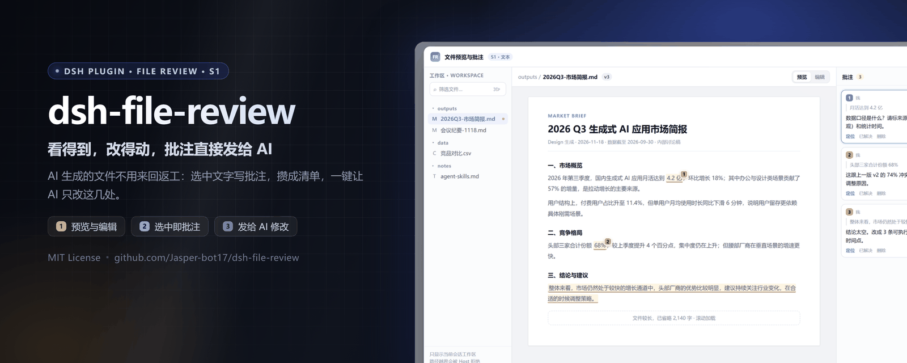
</p>

<p>
  <a href="https://github.com/Jasper-bot17/dsh-file-review/releases/latest"></a>
  <a href="https://github.com/Jasper-bot17/dsh-file-review/actions/workflows/ci.yml"></a>
  <a href="LICENSE"></a>
</p>

> 当前版本 **v0.2.0**（2026-11-27）：在 v0.1.0 的「预览 / 编辑 / 批注 / 回传 AI」闭环上，新增**批注持久化、多文件标签、快捷键、外部修改提示**。

## 为什么做

AI 写完一个文件，人打开总会发现细节问题；用聊天一句句描述回去，既费 token，又容易改出新问题。

这个插件把「预览 → 直接改 / 批注 → 发回 AI」放进同一个面板：批注自带**文件路径、版本、位置（行号 / 页码 / 单元格）、原文摘录和你的意见**，AI 收到的是可执行的结构化反馈，不是「第 4 段再改改」。

## 功能

**预览与编辑**

- 文本类：`.md` `.txt` `.csv` `.json` `.yaml` 与常见代码文件（`.py` `.js` `.ts` `.html` `.css` 等）直接预览、编辑、保存；写回前自动生成 `.bak`，并发修改返回冲突而不是覆盖。
- Office：`docx` `pptx` 本地转页图 + **透明文字层**，可像文本一样选中原文加批注；无文字层（扫描件等）时提示只能用整页批注。
- PDF：按页渲染 + 文字层，支持选中批注。
- 表格 `xlsx`：**DOM 表格**渲染（行号列标、网格线、列宽、合并单元格、文字原生可选），批注落到单元格或区域；支持冻结窗格；大表默认渲染 1,000 行并明确提示截断，可确认后加载全部（上限 20,000 行 / 30 万格）。
- 图片：`png` `jpg` `gif` `webp` `bmp` 只读预览 + 整图批注。
- 错误态：加密 / 超大 / 转换超时 / 坏 XML 统一错误卡（一句人话 + 技术细节折叠 + 重试），已有批注不丢。

**批注与回传**

- 选中文本按行号区间批注；Office / PDF 按页 + 文字层选区；表格按单元格 / 区域；图片按整图。
- 「发给 AI」把批注格式化为结构化消息（文件路径 + 版本 + `L<起>-<止>` / 页码 / 单元格 + 原文摘录 + 意见），先确认再发送。
- 支持导出批注为 Markdown（`.annotations.md`）。

**v0.2.0 新增**

- **批注持久化**：批注改动自动保存到当前会话工作区 `.dsh-file-review/`；重开面板或刷新页面后自动还原，文件被外部改动时给出 stale 标记而不是错位锚号。
- **多文件标签**：一次最多打开 8 个文件，标签切换、关闭。
- **快捷键**：`Ctrl/Cmd + S` 保存、`Ctrl/Cmd + Enter` 发送批注、`Esc` 关闭面板 / 取消。
- **外部修改提示**：文件被 AI 或编辑器改动后面板提示「内容已更新」，可一键刷新；有未保存编辑时先提示冲突。

**计划中（0.3.0）**

- AI 改完原地刷新并高亮**行级 diff**、拖拽打开文件、更多格式支持。

## 界面预览

> 图为 **v0.2.0 最终构建的真机截图**（隔离实例 50125，演示用假数据、已脱敏；hero 与架构图为设计稿渲染），素材规范见 [`docs/assets/README.md`](docs/assets/README.md)。

<p align="center">
  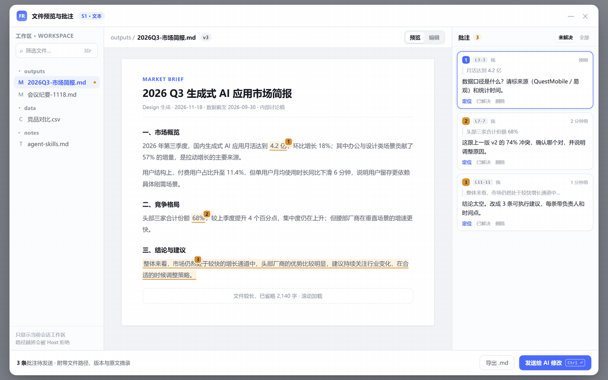
</p>

**文本批注**


工作区任意 md / txt / csv / 代码，点开就是可编辑的预览，右侧是批注栏。


选中一段文字，写一句意见，批注就挂在原文上 —— 不用复制粘贴给 AI。

**发给 AI 前的确认**


发给 AI 前先看清楚：文件、版本、每条批注的行号和原文都在消息里，可勾选、可改。

**v0.2.0 新增**

| 多文件标签 | 批注持久化 | 外部修改提示 |
|---|---|---|
| 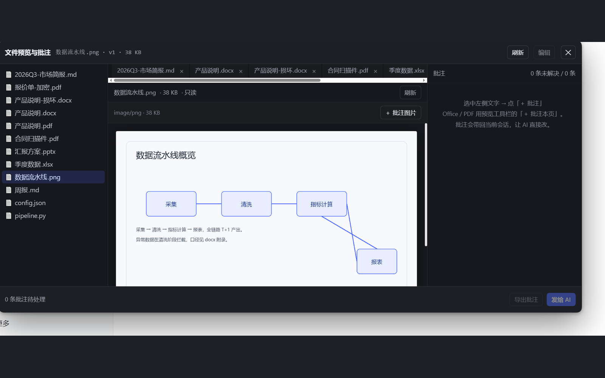 |  | 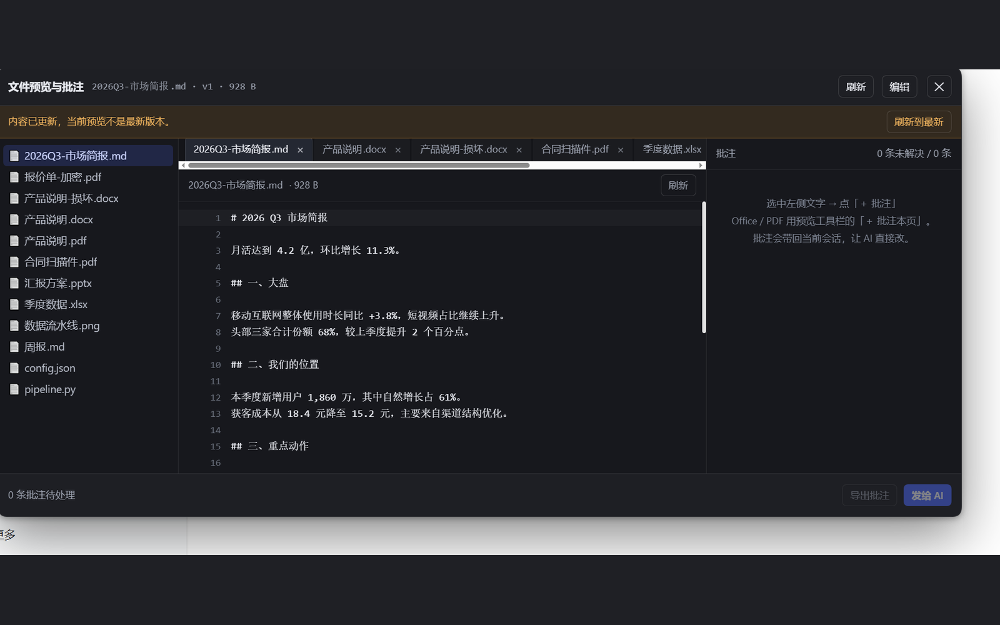 |

**Office / PDF**


**表格**

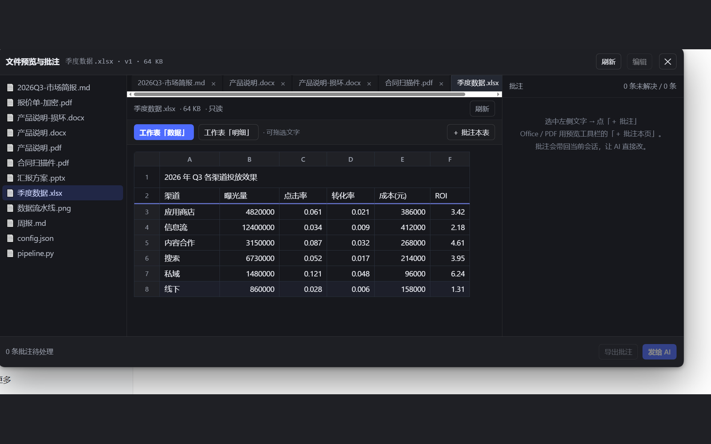


**图片**


**边界与状态**

| 扫描件无文字层 | 加密 / 超大 / 超时 | 大表截断 |
|---|---|---|
| 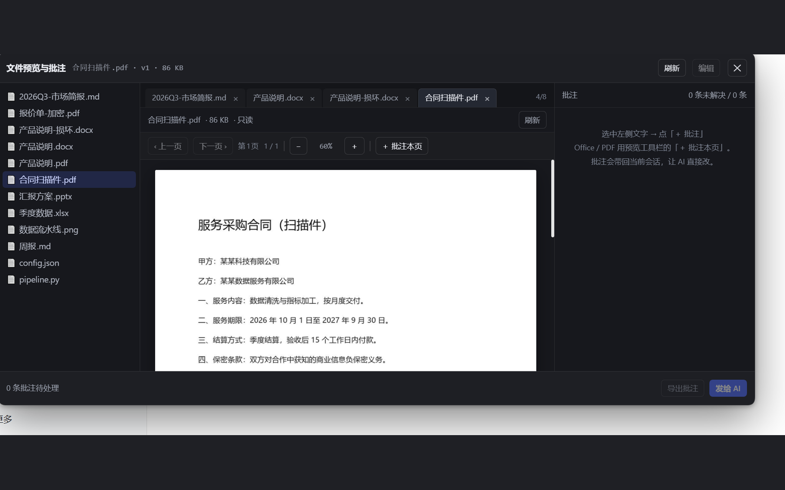 |  |  |

| 转换中（骨架屏 + 可取消） | 转换失败（一句人话 + 折叠详情 + 重试） |
|---|---|
| 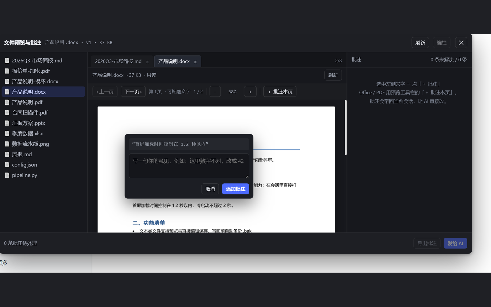 | 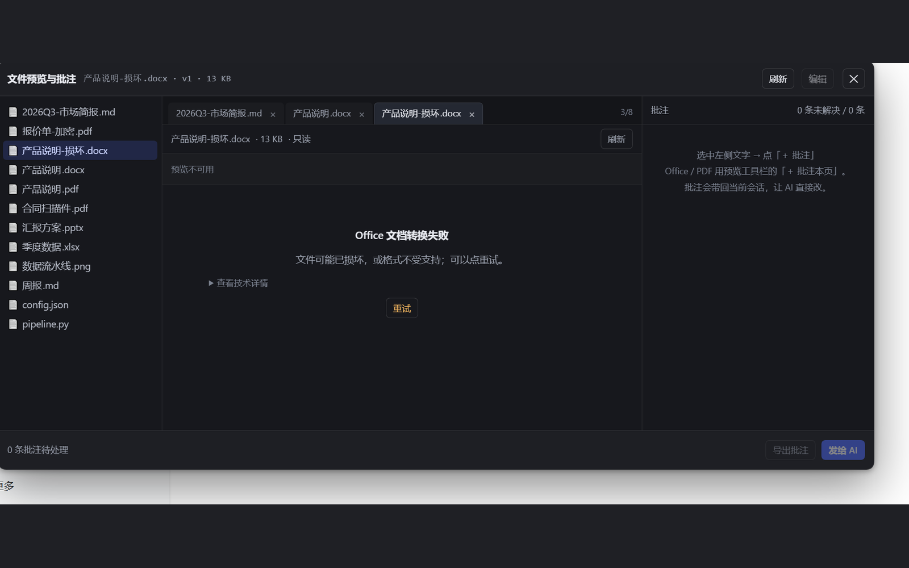 |

**深色模式**


| 深色下看 Office | 深色下选字批注 | 深色下看表格 |
|---|---|---|
| 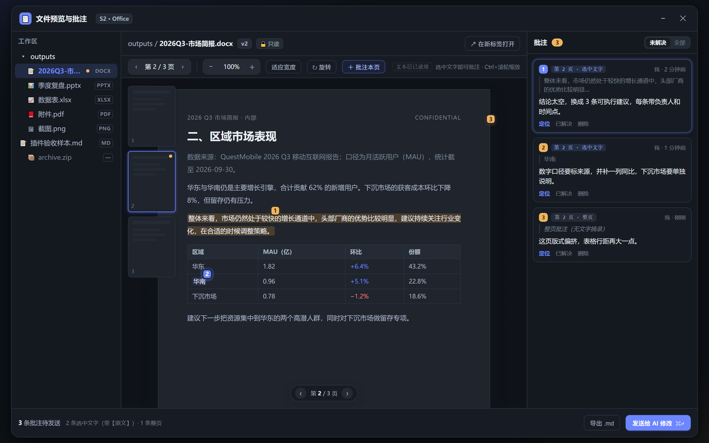 | 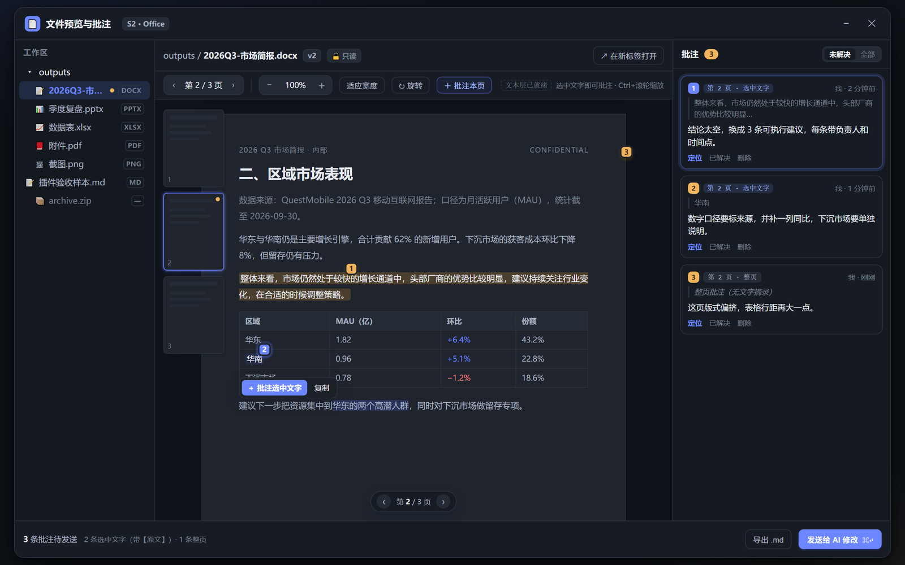 | 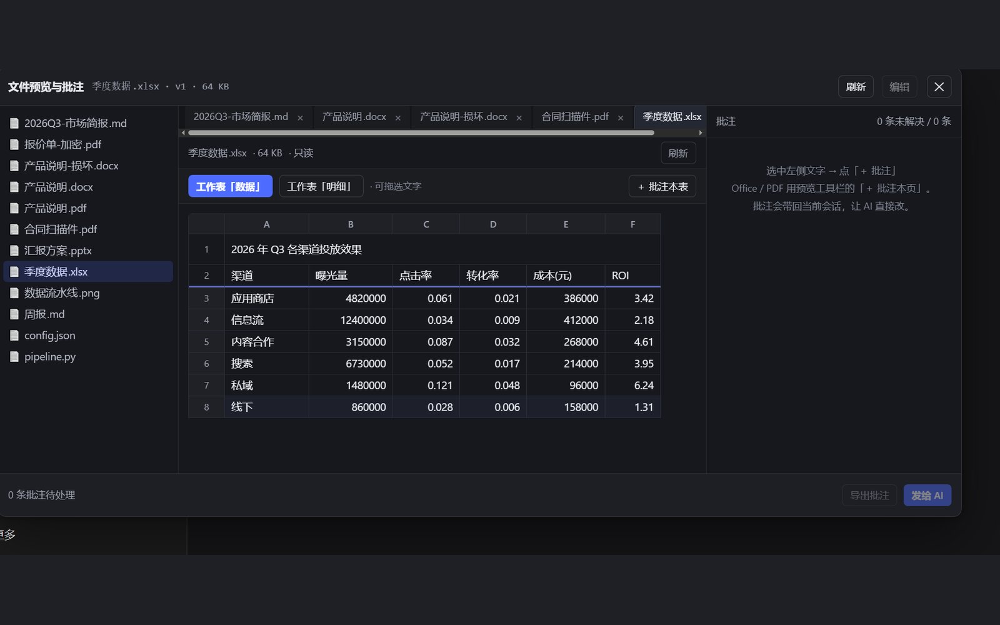 |

## 安装

前置：**Node.js >= 22.13**（推荐 24 LTS；PDF 解析依赖 `pdfjs-dist 6.5.438`，22.0–22.12 不可用）。Windows PowerShell 下 `npm.ps1` 可能被执行策略拦截，用 `npm.cmd` 调用。

```powershell
# 1) 装依赖并构建
& "C:\Program Files\nodejs\npm.cmd" install
& "C:\Program Files\nodejs\npm.cmd" run build    # tsc 出 Host 半 + tsdown 出 Client 半
& "C:\Program Files\nodejs\npm.cmd" run verify   # 构建 + bundle 契约 + Host/Client 离线自测

# 2) 装进 desktop profile（本地路径）
dsh plugin --profile desktop add "C:\...\dsh-file-review"
```

- Host 半插件装进 desktop profile 后**需要重启桌面宿主**才生效（重启会断当前会话、端口会变）；之后仅改 Client 半时 rebuild + 刷新页面即可。
- 验证是否装进组合树，**不要**用 `dsh --profile desktop --dump-config`：desktop profile 由 Electron 桌面宿主独占管理，该命令会报 `profile "desktop" is managed exclusively by the Electron application`（exit 1）。可行方式：在隔离 `DSH_HOME` 里装 web profile 后 `dsh --profile web --dump-config` 检查，或重启后看会话输入条左侧是否出现「📝 批注」入口。
- 工程依赖统一用 **npm**（仓库带 `package-lock.json`）。`dsh plugin` 内部用 DSH 自带的 pnpm 装插件，那只服务装插件，不要混 lockfile。
- 安装、卸载、重启影响、免重启验收的权威版本见 [docs/install.md](docs/install.md)。

## 使用

1. 打开 Web GUI 会话，点输入条左侧「📝 批注」入口打开浮层面板。
2. 在文件树里选工作区内的文件；需要对照时用标签打开多个文件（最多 8 个）。
3. 文本文件：直接改 → `Ctrl/Cmd+S` 保存；或选中一段 → 加批注。
   Office/PDF：在页图上选中原文 → 加批注；无文字层时用「＋ 批注本页」兜底。
   表格：点单元格或拖选区域 → 加批注。
   图片：整图批注。
4. 点「发给 AI」，确认结构化批注消息进入输入框，可先改再发。
5. 批注会自动持久化，重开面板 / 刷新页面后还原；也可以导出 `.annotations.md` 归档。
6. AI 改完文件后，面板提示「内容已更新」，一键刷新即可看到新内容。

完整操作与边界说明见 [docs/usage.md](docs/usage.md)。

## 配置

插件当前**没有独立的设置页或配置文件**，行为随 DSH 主题和当前会话工作区走：

| 项 | 说明 |
|---|---|
| 批注存储 | `<会话工作区>/.dsh-file-review/`（运行时目录，建议加入 `.gitignore`）；上限 **512 KB/文件、500 条批注** |
| 写回备份 | 覆盖保存前生成同名 `.bak` |
| 面板尺寸 | 记在浏览器 localStorage |
| 主题 | 跟随 DSH Web GUI 的深色 / 浅色 |
| 隔离验收实例 | 用 `DSH_HOME` 指到独立目录 + `dsh web --port <空闲端口>`（见 [docs/install.md](docs/install.md) §4） |

## 快捷键

| 快捷键 | 作用 |
|---|---|
| `Ctrl/Cmd + S` | 保存当前文件 |
| `Ctrl/Cmd + Enter` | 发送批注消息 |
| `Esc` | 关闭面板 / 取消当前编辑 |

## FAQ

**Q：装了插件但输入条看不到「📝 批注」入口？**  
Host 半只在桌面宿主启动时组装。`dsh plugin add` 后要重启桌面应用；仅更新 Client 半则 rebuild 后刷新页面即可。

**Q：页面一直停在 loading？**  
一般是插件 boot 失败（entropy：`package.json` 缺 `"dsh": {"client": {"platform": "web"}}` / 缺 `./client` 导出 / 插件 `apply` 抛错）。看宿主终端或浏览器 Console 的报错；构建契约可用 `npm run check` 自检。

**Q：点「发给 AI」没反应？**  
v0.2.0 走 Host `/plugins/dsh-file-review/api/send`，请求失败时面板会提示并给出复制兜底。若日志显示 `canSendToSession()` 为 false，看当前会话是否处于可接收输入状态。

**Q：表格只显示 1,000 行？**  
大表默认渲染前 1,000 行并显示截断条，避免卡死；点「加载全部」可继续（上限 20,000 行 / 30 万格）。这是有意设计，不是加载失败。

**Q：扫描件 / 纯图片 PDF 为什么改不了字？**  
没有文字层就没有可选文字，只能用「＋ 批注本页」整页批注；要改内容请让 AI 改源文件。

**Q：批注存在哪里？重装会丢吗？**  
存在当前会话工作区的 `.dsh-file-review/` 里，跟工作区走，不随插件卸载删除。需要归档时用「导出 .md」。

**Q：Node.js 版本有什么要求？**  
>= 22.13 或 24 LTS；22.0–22.12 会在 PDF 解析处失败。

**Q：怎么卸载？**  
`dsh plugin --profile desktop remove dsh-file-review`，然后重启桌面宿主。

更多排障见 [docs/troubleshooting.md](docs/troubleshooting.md)。

## 架构

插件是 **Host + Client 双半**结构：Client 半注册 `shell.overlay` 浮层面板与 `conversation.input.left` 入口，通过 `fetch` 调 Host 半在 `/plugins/dsh-file-review/api/*` 上的本地路由；文件读写、格式转换、批注持久化都在 Host 侧完成，路径被锁死在**当前会话工作区**内。

一句话数据流：`浏览器面板 → fetch → Host 路由 → 路径栅栏 → 本地解析/转换 → JSON / PNG / 文本层 → 面板渲染`。

详见 [docs/architecture.md](docs/architecture.md)。

## 安全边界

- Host 侧 `/plugins/dsh-file-review/api/*` 只读写**当前会话工作区**内的路径：realpath 校验，拒绝 `..` 穿越、系统目录，拒绝把盘根当工作区；批注存储路径由服务端派生。
- 只通过 `127.0.0.1` 的 Web GUI 使用，不对外提供服务。
- 写回前自动生成 `.bak`；外部并发改动返回 409 冲突而不是覆盖。
- Office 转页图、PDF 文字层、xlsx 解析、批注持久化都在本地完成，不上传文件。
- xlsx 手写 XML/zip 解析带条目数、单条大小上限并禁用外部实体；批注消息与导出内容中的路径、原文做 Markdown 转义。

## 开发

```powershell
& "C:\Program Files\nodejs\npm.cmd" install
& "C:\Program Files\nodejs\npm.cmd" run typecheck  # Host / Client 两套 tsc 配置
& "C:\Program Files\nodejs\npm.cmd" run build      # tsc + tsdown → lib/index.js + lib/client.js
& "C:\Program Files\nodejs\npm.cmd" run check      # client bundle 契约校验（banner/footer/id/外部化）
& "C:\Program Files\nodejs\npm.cmd" test           # Host 自测 + Client 装载自测
& "C:\Program Files\nodejs\npm.cmd" run verify     # build + check + test 一条龙（CI 入口）
```

工程结构：`src/`（Host 与 Client 源码）、`lib/`（构建产物）、`scripts/`（bundle 校验与自测）、`cordis.patch.yml`（插件树插入声明）、`docs/`（文档）、`.github/`（issue 模板与 CI）。

构建约束（详见 [CONTRIBUTING.md](CONTRIBUTING.md)）：Client 半需 `"dsh": {"client": {"platform": "web"}}` 与 `./client` 导出；bundle 必须是 CJS closure factory（banner `window.__ModuleLoader__.load({ id: "<包名>", factory: (require) => {`）；`react`、`react-dom`、`@deepseek-ai/*` 平台模块必须外部化；`@deepseek-ai/*` 只允许 `import type`；前端扩展只走 Slot。

## 路线图

| 版本 | 内容 | 状态 |
|---|---|---|
| 0.1.0 | 预览 / 编辑 / 批注 / 发给 AI 闭环；docx / xlsx / pptx / pdf / 图片 | 已发布（2026-11-22） |
| 0.2.0 | 批注持久化、多文件标签（≤8）、快捷键、外部修改提示；CI 升 v5、文档重写、真机截图 | **当前版本**（2026-11-27） |
| 0.3.0 | 行级 diff 高亮、拖拽打开、批注导出增强 | 计划 |

## 文档

- [docs/install.md](docs/install.md)：安装、卸载、重启影响、免重启验收、验收清单
- [docs/usage.md](docs/usage.md)：完整操作指南与边界
- [docs/architecture.md](docs/architecture.md)：Host/Client 结构、API、数据模型与构建
- [docs/troubleshooting.md](docs/troubleshooting.md)：常见问题排查
- [docs/release-notes-0.2.0.md](docs/release-notes-0.2.0.md)：0.2.0 Release notes
- [SECURITY.md](SECURITY.md)：安全边界与私密漏洞报告
- [CHANGELOG.md](CHANGELOG.md) / [CONTRIBUTING.md](CONTRIBUTING.md)
- `docs/assets/`：README 截图与演示 GIF（素材规范见 `docs/assets/README.md`）

## 贡献

见 [CONTRIBUTING.md](CONTRIBUTING.md)。安全问题请勿公开开 issue，按 [SECURITY.md](SECURITY.md) 走私密报告通道。

## 许可证

[MIT](LICENSE)。

## 致谢

- DSH 插件开发指南：<https://github.com/anweat/dsh-plugin-dev-guide>
- 同类先例：[actcwlf/dsh-any-preview](https://github.com/actcwlf/dsh-any-preview)、[dadgrand/dsh-file-preview](https://github.com/dadgrand/dsh-file-preview)（只做预览；本项目补「批注 → 回传 AI」闭环）
