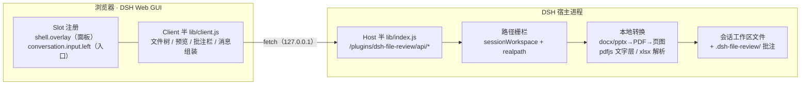
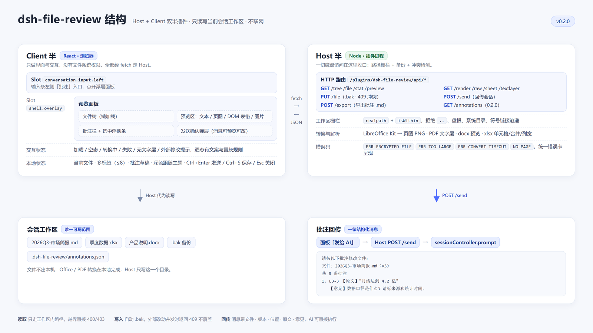

# 架构说明

写给要改代码的人：插件怎么分两半、请求怎么走、数据长什么样、构建和打包有哪些硬约束。

## 1. 总览

DSH 插件是 **Host + Client 双半**结构，同一个 npm 包两个入口：

- **Host 半**（`lib/index.js`，`main` 导出）：跑在 DSH 宿主进程里，注册 HTTP 路由、读写文件、做格式转换与批注持久化。
- **Client 半**（`lib/client.js`，`exports["./client"]`）：跑在 Web GUI 前端，注册浮层面板与输入条入口，所有文件操作都通过 `fetch` 调 Host。



**为什么拆两半**：浏览器里拿不到任意文件系统访问，也不能跑 LibreOffice / pdfjs 这类重活；反过来，Host 拿不到前端 Slot。两边通过本地 HTTP 路由通信是最小、可调试、可离线验证的通道（本插件也评估过 `@Remote` / Typert 的强类型 RPC，v0.2 阶段不引入，减少 wire 契约维护成本）。



## 2. Client 半

入口 `src/client/index.tsx`，注册两个 Slot：

| Slot | 用途 |
|---|---|
| `conversation.input.left` | 输入条左侧「📝 批注」按钮，点击开/关面板 |
| `shell.overlay` | 浮层面板本体（文件树 + 预览 + 批注栏） |

主要模块：

| 文件 | 职责 |
|---|---|
| `src/client/panel.tsx` | 面板 UI：文件树、预览、批注气泡/列表、确认发送、错误卡、外部修改提示、多文件标签 |
| `src/client/api.ts` | 对 Host API 的类型化封装（统一 BASE = `/plugins/dsh-file-review/api`） |
| `src/client/store.ts` | 面板状态：当前文件、批注集合、发送通道探测与兜底 |
| `src/client/message.ts` | 批注 → 结构化消息的格式化（路径 / 版本 / 位置 / 原文 / 意见，Markdown 转义） |
| `src/client/css.ts` | 样式与主题变量（跟随 DSH 深浅色） |
| `src/client/types.ts` | 前后端共享的数据类型 |

Client 不直接碰文件系统，也不自己判断路径安全——安全判断只在 Host 侧做一次。

## 3. Host 半与 API

入口 `src/index.ts`，用一条 `ctx.webServer.register({ kind: 'prefix', path: '/plugins/dsh-file-review/api' })` 挂本地路由，再按 `method + 子路径` 分发（`API_PREFIX = '/plugins/dsh-file-review/api'`）。

### 3.1 路由表

| 方法 | 路由 | 用途 |
|---|---|---|
| GET | `/api/tree` | 列出工作区某目录（懒加载） |
| GET | `/api/file` | 读文本文件（含版本信息） |
| PUT | `/api/file` | 保存文本文件（先 `.bak`，版本不符 409） |
| GET | `/api/stat` | 文件大小 / mtime / 版本，用于外部修改检测 |
| POST | `/api/export` | 导出当前文件批注为 Markdown（只写工作区内派生路径） |
| POST | `/api/send` | 把批注消息送进当前会话（`ctx.sessionController.prompt`） |
| GET | `/api/preview` | 预览元数据：类型、页数/行数、是否需转换、截断信息 |
| GET | `/api/sheet` | xlsx 单元格 / 列宽 / 行高 / 合并区域（DOM 表格数据） |
| GET | `/api/render` | 按页返回 PNG 页图 |
| GET | `/api/document` | 返回缓存 PDF（Office 先转换，PDF 原样） |
| GET | `/api/textlayer` | 某页的归一化文字块坐标（供透明文字层） |
| GET | `/api/raw` | 图片原样字节；视频 / 音频二进制（`Range` 200 / 206 / 416，补 `HEAD`，单文件 ≤ 4 GB） |
| GET / PUT | `/api/annotations` | v0.2.0：读 / 写当前文件的持久化批注（存储位置由 Host 从会话工作区推导） |

错误统一返回 JSON：`{ code, message, detail? }`，常用 code 见 §5。

### 3.2 请求处理顺序

1. Client 只传 **sessionId + 工作区相对路径**，不传绝对路径；
2. Host 用 `sessionWorkspace()` 取当前会话工作区，`fs.resolve` + `fs.contains`（realpath）校验目标在工作区内；
3. 盘根、`..`、绝对路径、工作区外 → 400 / 403；
4. 通过后做读写 / 转换 / 缓存；
5. 响应 JSON 或二进制（PNG / PDF / 图片）。

## 4. 数据模型

### 4.1 批注 `Annotation`

| 字段 | 说明 |
|---|---|
| `id` | 客户端生成，稳定标识（合并 / 墓碑按它对齐） |
| `path` | 工作区相对路径 |
| `fileSha1` | 批注时文件内容哈希（可能为 `null`）；与当前版本不一致 → stale 标记 |
| `from` / `to` | 1-based 行号区间；分页/块级批注另由 `page` / `block` 定位，行号仅作占位 |
| `quote` | 原文摘录（块级批注为空） |
| `text` | 意见正文 |
| `status` | `open` / `resolved` / `stale` |
| `createdAt` / `sentAt` | 时间戳；`sentAt` 仅在「发给 AI」成功后写入 |
| `page` | 分页文档（docx/pptx/pdf）的 1-based 页码 |
| `block` | 块级批注 `AnnotationBlock`：`{ page, label, sheet?, range?, selected? }`，用于页 / 工作表 / 单元格区域 / 整图 |

块级批注消息一律不带【原文】；`selected` 只是 UI 选中态，不进入消息。

### 4.2 持久化

- 位置：`<sessionWorkspace>/.dsh-file-review/`，按文件派生存储文件名（服务端派生，不接受客户端传路径）。
- 写入：临时文件 + rename 原子替换；单文件批注 JSON 上限 **512 KB（超限 413）**，每个文件最多 **500 条批注**。
- 并发：同一文件的写入串行化，按批注 `id` 合并 + 删除墓碑，并发写不丢批注；批注写入**不返回 409**。文件内容保存（`PUT /api/file`）才按版本（mtime + size / 内容哈希）不符返回 409。
- 隔离：不同会话的工作区互不可见。
- 导出：`.annotations.md` 只写工作区内派生路径，内容只来自服务端已存批注。

### 4.3 发送消息

`message.ts` 组装固定模板，保证 AI 拿到可执行反馈：

```text
请按以下批注修改文件：

文件：<相对路径>（<版本>）
共 N 条批注

1. L<起>-<止> 【原文】"<摘录>"
   【意见】<意见>

要求：只改批注涉及的内容，其余保持不变；改完告诉我改了哪几处。
```

块级批注（工作表 / 单元格 / 区域 / 图片）不带【原文】；路径与摘录做 Markdown 转义，防止消息被结构破坏。

## 5. 错误码

| code | HTTP | 场景 |
|---|---|---|
| `NO_SESSION` | 400 | 无会话 / 伪 sessionId |
| `BAD_PATH` | 400 | 相对路径非法（`..`、绝对路径、NUL） |
| `BAD_WORKSPACE` | 403 | 盘根当工作区、工作区外路径 |
| `FORBIDDEN` | 403 | 不是本机 DSH GUI 的请求（`isTrustedRequest` 拒绝） |
| `CONFLICT` | 409 | 文件内容已被外部修改，拒绝覆盖（**仅 `PUT /api/file`**；批注写入不会 409） |
| `UNSUPPORTED_PREVIEW` | 415 | `tiff` / `heic` 等浏览器不认识的格式（client 有专属标题「这个格式暂不支持预览 / tiff、heic 请先转成 PNG」） |
| `ERR_ENCRYPTED_FILE` | 422 | 加密文档 / PDF，无法预览 |
| `TOO_LARGE` | 413 | 超出大小上限（文件内容 > 2 MB、批注 JSON > 512 KB、批注消息超长） |
| `ERR_TOO_LARGE` | 413 | 预览文件超过 30 MB（仅 `/api/preview` 路径，client 有专门文案） |
| `ERR_CONVERT_TIMEOUT` | 504 | 文档转换超时 |
| `BAD_XML_ENTITY` | 400 | 非法 XML 字符实体（xlsx 解析） |
| `UNSAFE_XML` | 400 | xlsx 含 DOCTYPE / ENTITY 等不安全 XML 声明，拒绝解析 |
| `NO_SHEET` | 404 | 工作表读取失败；根因放在 `detail.reason`（如 `ZIP_TOO_MANY_ENTRIES` 等，**不作为顶层 code**） |

批注存储坏 JSON 时按空批注处理、不返回错误码；显式 `degraded` 提示与坏文件改名列 0.2.1。其余错误见 `src/index.ts` 的 `ReviewError` 列表。

## 6. 构建与打包

- `npm run build`：`tsc` 编 Host 半 + 类型声明到 `lib/`，`tsdown` 打 Client 半到 `lib/client.js`。
- Client bundle 必须是 CJS closure factory：
  - banner：`window.__ModuleLoader__.load({ id: "dsh-file-review", factory: (require) => {`
  - footer：`return module.exports; } });`
  - `intro` 注入 `var module = { exports: {} };`，`clean:false`、`codeSplitting:false`。
- 平台模块必须外部化：`react`、`react/jsx-runtime`、`react-dom`、`react-dom/client`、`@deepseek-ai/*` 客户端包等；`@deepseek-ai/*` 只允许 `import type`。
- `package.json` 必须声明 `"dsh": { "client": { "platform": "web" } }` 与 `"./client"` 导出；`cordis.patch.yml` 声明插件树插入。
- 校验链：`npm run check`（bundle 契约：banner/footer/id/外部化）→ `test:host`（Host 路由与安全用例）→ `test:client`（Client 装载自测）→ `verify` 全串。
- CI：`.github/workflows/ci.yml`，`windows-latest` + `npm ci` + `npm run verify`（测试里有 Windows 口径断言，见 CONTRIBUTING）。

## 7. 设计取舍

| 取舍 | 原因 |
|---|---|
| Host 侧做路径校验 | 浏览器不可信；单点校验避免前端绕过 |
| 不做前端重型预览库（pdfjs bundle 36.7 MB） | 转换与解析放 Host，bundle 保持轻量、离线可用 |
| xlsx 用 DOM 表格而非转页图 | LibreOffice 导 PDF 默认不带网格线/行列标，用户体验差 |
| 批注持久化放工作区而非插件目录 | 跟工作区一起迁移 / 随会话隔离，且可用 Git 管理 |
| v0.2 不引入 Typert/@Remote | 减少 wire 契约与类型生成链，先稳定行为；后续需要再迁 |

## 8. 已知限制

- 行级 diff 高亮未做（0.3.0）；当前只提示文件已更新并支持刷新。
- 扫描件、纯图片 PDF 无文字层，只能整页批注。
- Office 转换依赖本机能力（DSH 内置转换链），不同环境速度差异大。
